<div align="center">

    


<br>

**→ Desenvolvido por: Ana Livia • Beatriz Batista • Jayane Elias **

</div>


## Sobre o Projeto

O **Prosa** é uma plataforma desenvolvida com o objetivo de combater o isolamento social de pessoas idosas, incentivando a interação, a criação de amizades e a participação em atividades sociais.

O sistema oferece recursos que permitem aos usuários explorar comunidades, conhecer pessoas, acompanhar eventos e estabelecer novas conexões.

O projeto busca proporcionar um ambiente acessível, acolhedor e intuitivo, facilitando a inclusão digital e a interação social.

<br>

## Tecnologias Utilizadas

| Tecnologia | Descrição |
|:---:|---|
| **Laravel** | Framework utilizado no desenvolvimento do sistema. |
| **Laravel Breeze** | Estrutura de autenticação para login, cadastro e gerenciamento de acesso. |
| **PHP** | Linguagem utilizada no Back-end. |
| **Composer** | Gerenciamento das dependências do PHP. |
| **Node.js** | Ambiente utilizado para as dependências do Front-end. |
| **MySQL** | Sistema de gerenciamento de banco de dados utilizado no projeto. |
| **phpMyAdmin** | Ferramenta utilizada para administrar e visualizar o banco de dados. |
| **Front-end** | Interface visual da plataforma integrada ao Laravel. |

<br>

## Funcionalidades

- **Página Inicial:** apresentação da plataforma e de sua proposta.
- **Cadastro e Login:** criação de contas e autenticação dos usuários.
- **Dashboard:** painel principal com acesso às funcionalidades da plataforma.
- **Explorar:** descoberta de conteúdos e novas conexões.
- **Perfil:** criação, edição e exclusão do perfil do usuário.
- **Amigos:** área destinada às amizades e conexões entre usuários.
- **Comunidades:** criação, consulta, edição e exclusão de comunidades.
- **Eventos:** criação, consulta, edição e exclusão de eventos.
- **Interesses:** gerenciamento dos interesses dos usuários.
- **Controle de acesso:** gerenciamento de permissões por meio de Middlewares.

<br>

## Telas do Sistema

As imagens abaixo apresentam algumas das principais interfaces desenvolvidas para a plataforma.

<div align="center">

| Página Inicial | Cadastro | Login |
|:---:|:---:|:---:|
| 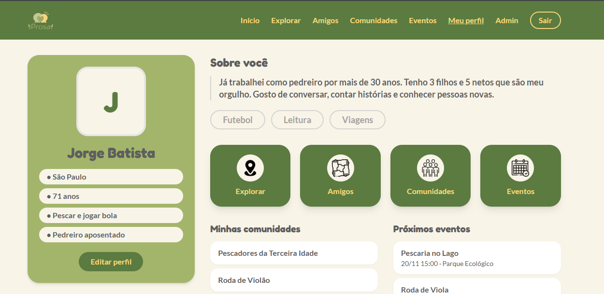 |  | 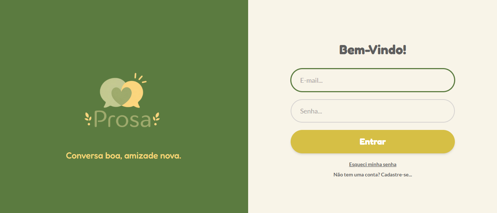 |
| **Home** | **Cadastro** | **Login** |

| Dashboard | Explorar | Amigos |
|:---:|:---:|:---:|
| 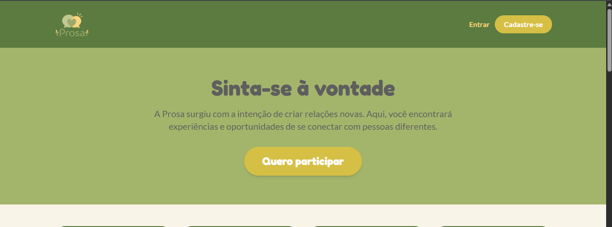 | 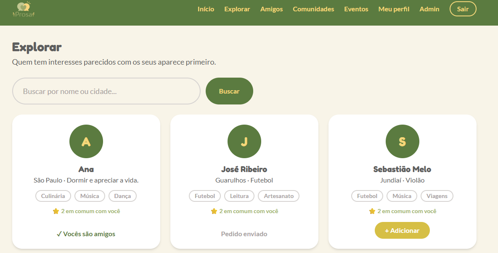 | 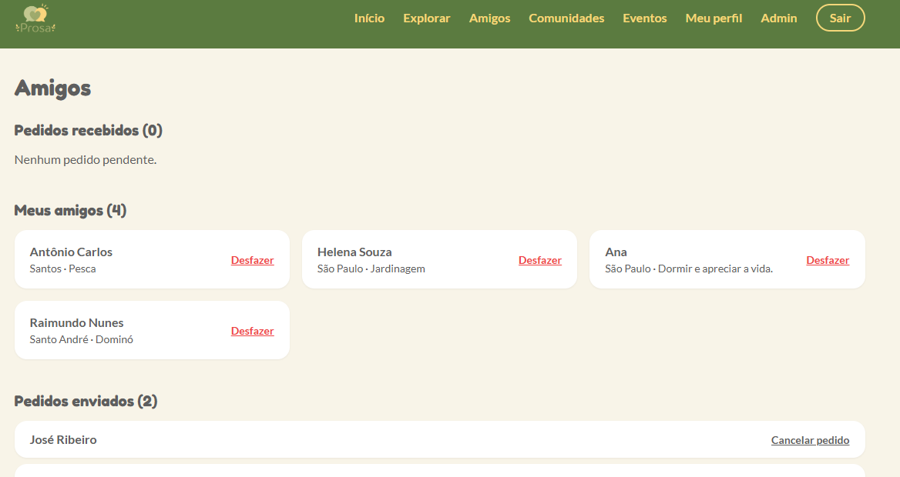 |
| **Painel de Controle** | **Exploração** | **Conexões** |

| Comunidades | Eventos | Fallback |
|:---:|:---:|:---:|
| 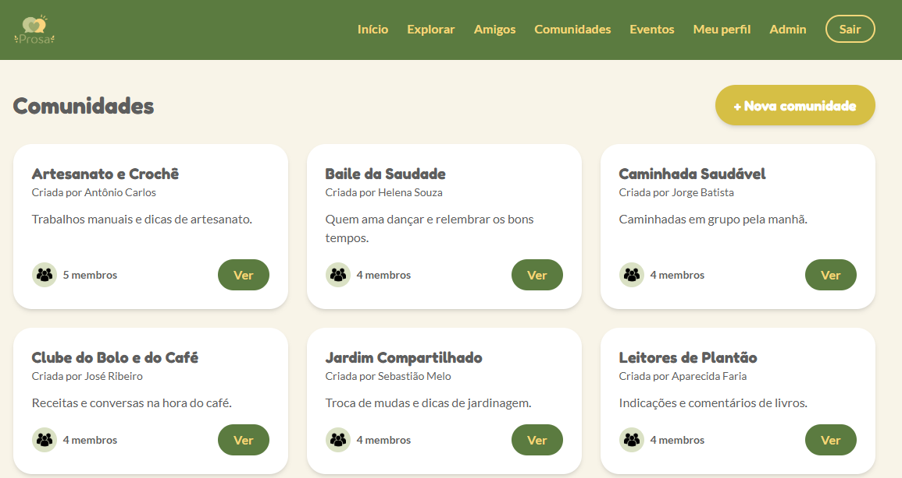 | 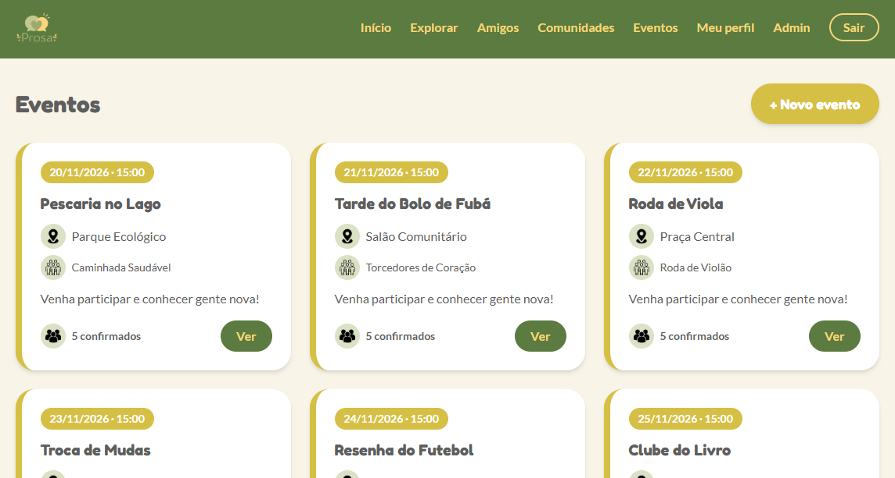 |  |
| **Comunidades** | **Eventos** | **Página de Erro 404** |

</div>

<br><br>

## Estrutura do Back-end

O Back-end foi organizado utilizando a estrutura MVC (Model-View-Controller) do Laravel, separando as responsabilidades de gerenciamento dos dados, processamento das requisições e controle de acesso.

<br>


### Models

Os Models representam as entidades utilizadas para estruturar e manipular os dados da aplicação.

| Arquivo | Descrição |
|:---:|---|
| `Amizade.php` | Representa os relacionamentos de amizade entre usuários. |
| `Comunidade.php` | Representa as comunidades da plataforma. |
| `Evento.php` | Representa os eventos cadastrados no sistema. |
| `Interesse.php` | Representa os interesses registrados na plataforma. |
| `User.php` | Representa os usuários cadastrados. |

<br>

### Controllers

Os Controllers recebem e processam as requisições, realizando a comunicação entre as telas e os Models.

| Arquivo | Descrição |
|:---:|---|
| `AmizadeController.php` | Gerenciamento das operações relacionadas às amizades. |
| `ComunidadeController.php` | Gerenciamento das comunidades. |
| `DashboardController.php` | Controle das informações apresentadas no painel principal. |
| `EventoController.php` | Gerenciamento dos eventos. |
| `ExplorarController.php` | Controle da funcionalidade de exploração. |
| `HomeController.php` | Controle da página inicial. |
| `OnboardingController.php` | Gerenciamento do fluxo de apresentação inicial. |
| `ProfileController.php` | Gerenciamento do perfil dos usuários. |
| `Admin/InteresseController.php` | Gerenciamento administrativo dos interesses. |
| `Admin/UsuarioController.php` | Gerenciamento administrativo dos usuários. |

<br>

### Middlewares

Os Middlewares verificam determinadas condições antes de permitir o acesso a algumas rotas.

| Arquivo | Descrição |
|:---:|---|
| `EnsureOnboardingComplete...` | Verificação relacionada à conclusão do processo de onboarding. |
| `EnsureUserIsAdmin.php` | Verificação de permissões para restringir o acesso às funcionalidades administrativas. |

<br>

## Banco de Dados

O projeto utiliza **MySQL** para armazenar e organizar as informações da plataforma, com gerenciamento realizado por meio do **phpMyAdmin**.

A estrutura do banco de dados foi desenvolvida utilizando Migrations, enquanto os Seeders são responsáveis pela inserção de dados iniciais.

<br>

### Migrations

As Migrations definem a estrutura e a criação das tabelas utilizadas no banco de dados.

Entre as estruturas implementadas estão:

| Migration | Descrição |
|:---:|---|
| `create_users_table` | Criação da tabela de usuários. |
| `create_cache_table` | Criação da tabela de cache. |
| `create_jobs_table` | Criação da tabela de tarefas. |
| `add_prosa_fields_to_users` | Adição de campos relacionados ao Prosa na tabela de usuários. |
| `create_interesses_table` | Criação da tabela de interesses. |
| `create_comunidades_table` | Criação da tabela de comunidades. |
| `create_eventos_table` | Criação da tabela de eventos. |
| `create_amizades_table` | Criação da tabela de amizades. |
| `create_interesse_user_table` | Estrutura de relacionamento entre usuários e interesses. |
| `create_comunidade_user_table` | Estrutura de relacionamento entre usuários e comunidades. |
| `create_evento_user_table` | Estrutura de relacionamento entre usuários e eventos. |

<br>

**Localização:** `database/migrations/`

<div align="center">

<!-- Inserir captura da pasta database/migrations -->

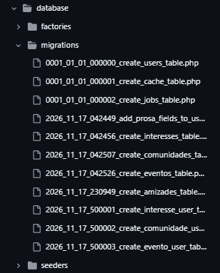

*Arquivos de Migrations do projeto.*

</div>

<br><br>

### Seeders

Os Seeders são utilizados para inserir dados iniciais no banco de dados, facilitando a preparação e a demonstração das funcionalidades da plataforma.

O projeto possui os seguintes arquivos:

| Seeder | Descrição |
|:---:|---|
| `DatabaseSeeder.php` | Seeder principal, responsável por organizar a execução dos demais Seeders, conforme sua configuração. |
| `UserSeeder.php` | Inserção de dados iniciais de usuários. |
| `AmizadeSeeder.php` | Inserção de dados iniciais de amizades. |
| `ComunidadeSeeder.php` | Inserção de dados iniciais de comunidades. |
| `EventoSeeder.php` | Inserção de dados iniciais de eventos. |
| `InteresseSeeder.php` | Inserção de dados iniciais de interesses. |

<br> 

**Localização:** `database/seeders/`

<div align="center">

<!-- Inserir captura da pasta database/seeders -->

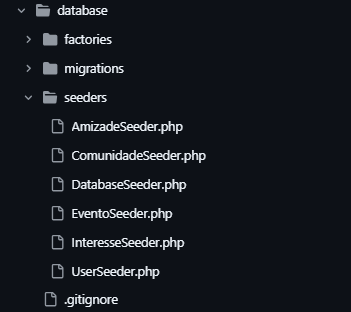

*Arquivos de Seeders do projeto.*

</div>

<br><br>

## Operações CRUD

O sistema implementa operações CRUD (Create, Read, Update e Delete), permitindo criar, consultar, atualizar e excluir registros no banco de dados.

As principais funcionalidades de gerenciamento são:

| Funcionalidade | Operações |
|:---:|---|
| **Perfil** | Criação, consulta, edição e exclusão. |
| **Eventos** | Criação, consulta, edição e exclusão. |
| **Comunidades** | Criação, consulta, edição e exclusão. |

<br><br>

### Front-end

As operações são realizadas por meio das interfaces da plataforma, permitindo que os usuários gerenciem seus perfis, eventos e comunidades.

<div align="center">

<!-- Inserir capturas das operações CRUD realizadas nas telas -->

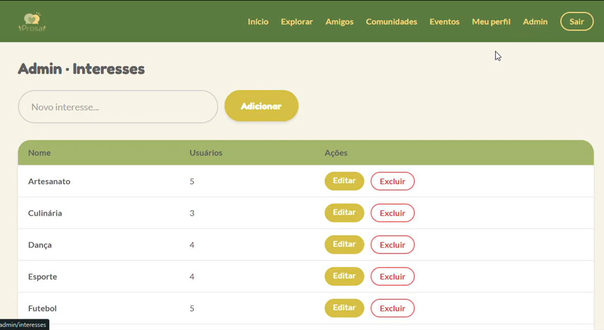

*Exemplos das operações CRUD realizadas pela interface.*

</div>

<br><br>

### Back-end

O processamento das operações é realizado pelos Controllers, que recebem as requisições, executam as ações necessárias e interagem com os Models para atualizar as informações no banco de dados.

<div align="center">

<!-- Inserir capturas dos Controllers, rotas e operações CRUD -->

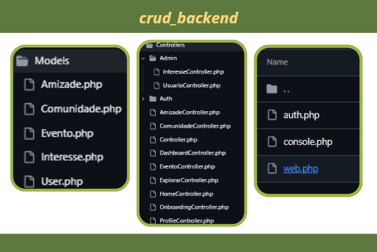

*Exemplos das operações CRUD implementadas no Back-end.*

</div>

<br><br>

## Autenticação e Controle de Acesso

O projeto utiliza o **Laravel Breeze** como estrutura de autenticação, disponibilizando os recursos necessários para o cadastro e login dos usuários.

Além disso, foram utilizados Middlewares para controlar o acesso a determinadas funcionalidades, incluindo a verificação de permissões administrativas e a conclusão do onboarding.

<br><br>

## Rota Fallback

Foi implementada uma rota Fallback para tratar acessos a endereços que não correspondem às rotas existentes no sistema, direcionando o usuário para uma página específica.

<div align="center">


*Página apresentada quando uma rota não é encontrada.*

</div>

<br><br>

## Execução do Projeto

Para executar o projeto localmente, é necessário possuir PHP, Composer, Node.js e MySQL configurados no ambiente de desenvolvimento.

<br>

**1. Clone o repositório:**

```bash
git clone LINK_DO_REPOSITORIO
```

**2. Acesse a pasta do projeto:**

```bash
cd NOME_DO_PROJETO
```

**3. Instale as dependências do PHP:**

```bash
composer install
```

**4. Instale as dependências do Front-end:**

```bash
npm install
```

**5. Configure o arquivo `.env` com as informações do banco de dados MySQL.**

Exemplo de configuração:

```env
DB_CONNECTION=mysql
DB_HOST=127.0.0.1
DB_PORT=3306
DB_DATABASE=prosa
DB_USERNAME=root
DB_PASSWORD=
```

**6. Gere a chave da aplicação:**

```bash
php artisan key:generate
```

**7. Execute as Migrations:**

```bash
php artisan migrate
```

**8. Execute os Seeders:**

```bash
php artisan db:seed
```

**9. Inicie o servidor Laravel:**

```bash
php artisan serve
```

**10. Inicie o ambiente de desenvolvimento do Front-end:**

```bash
npm run dev
```

Após iniciar os serviços, acesse o endereço disponibilizado pelo Laravel para visualizar a plataforma.

<br><br>

## Repositório

<div align="center">

**PROSA — Projeto de TCC**

[Acessar repositório no GitHub](LINK_DO_REPOSITORIO)

</div>


